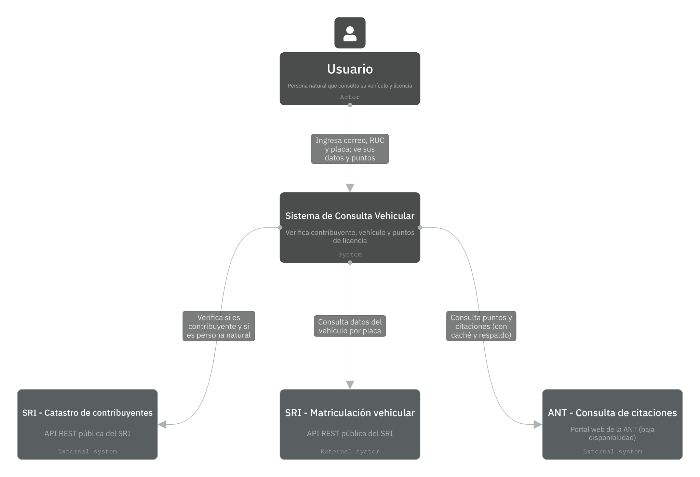
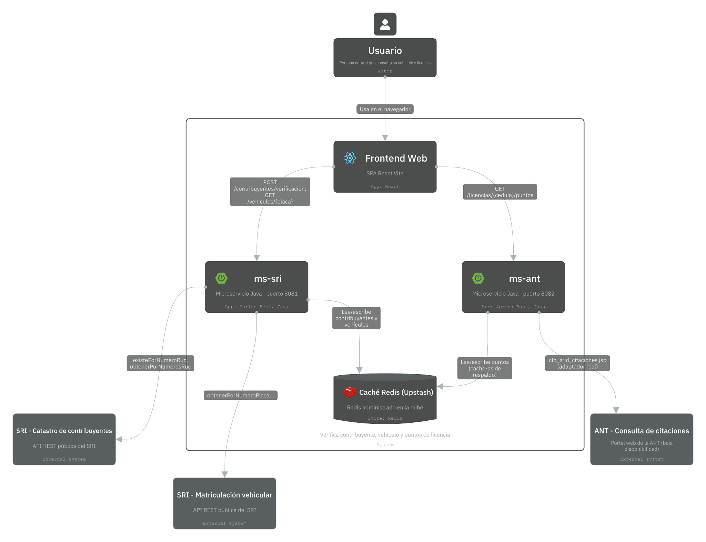
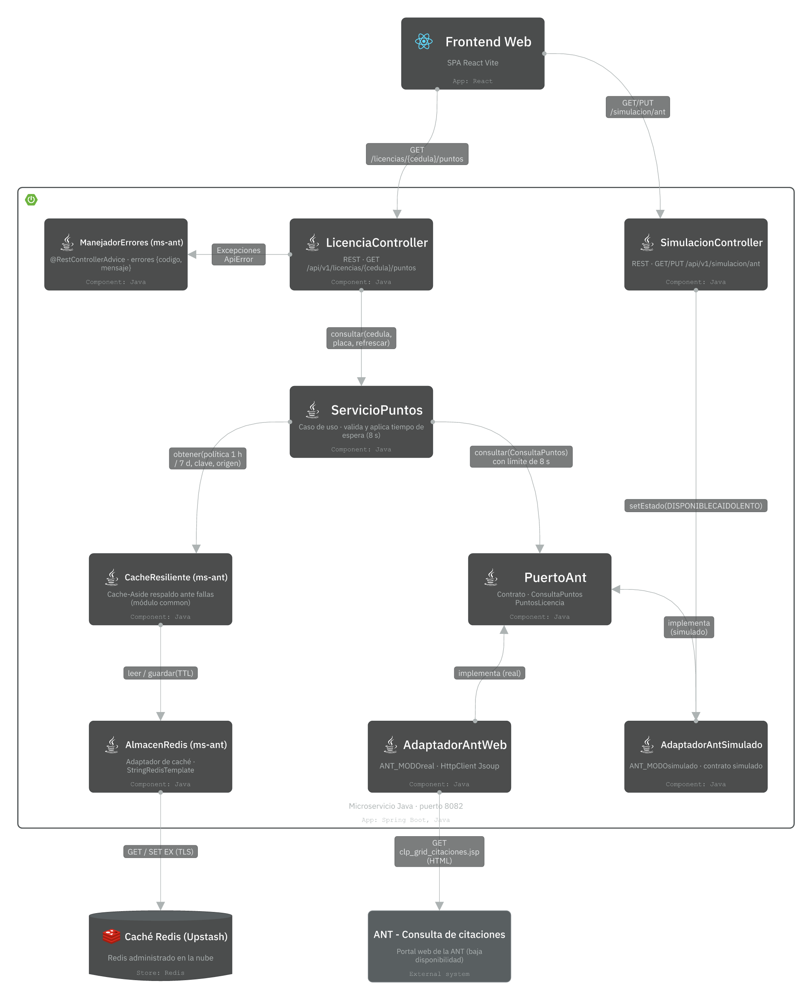
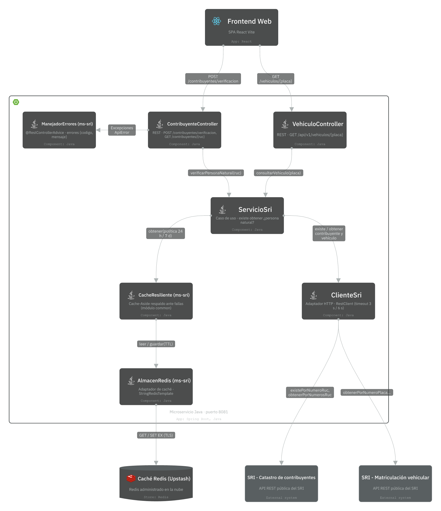
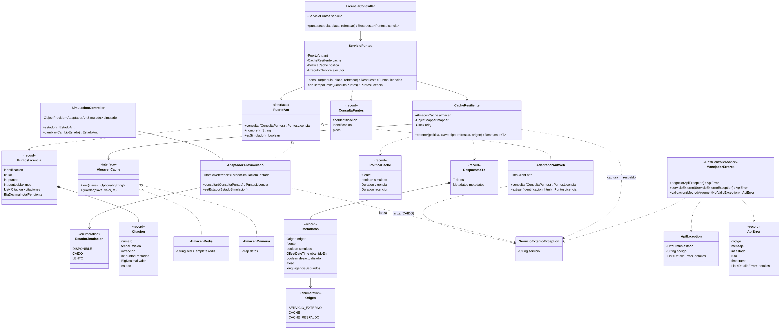
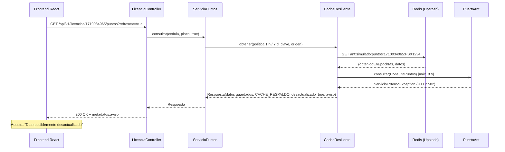

# Consulta vehicular: SRI + ANT con caché resiliente

Proyecto de **ISWZ2202 - Diseño y Arquitectura de Software** (UDLA). Sistema web donde un usuario ingresa su
correo y su RUC de persona natural, el sistema lo verifica en el SRI, muestra sus datos, consulta su vehículo por
placa y los puntos de su licencia en la ANT.

- **Frontend:** React 18 + Vite
- **Backend:** dos microservicios Java 17 / Spring Boot 3.3 (`ms-sri`, `ms-ant`) y un módulo común
- **Caché en la nube:** Redis administrado en **Upstash**
- **Modelo C4:** IcePanel (contexto y contenedores), enlazado a este repositorio

> **Situación de la ANT (17/11/2026):** la consulta de citaciones responde **HTTP 502 Bad Gateway**
> ([evidencia](evidencia/ANT-502-2026-11-17.md)). Siguiendo la indicación del docente, el cuarto servicio se mantiene
> en el diseño y se ejecuta con un **contrato simulado** que recibe y devuelve exactamente lo mismo que el servicio real.
> El adaptador real está implementado y se activa con `ANT_MODO=real`.

## Arquitectura (C4)

### Nivel 1: contexto



### Nivel 2: contenedores



### Nivel 3: componentes

**ms-ant**: controlador REST, caso de uso con tiempo de espera, caché resiliente y el puerto `PuertoAnt` con sus dos adaptadores (real y simulado).



**ms-sri**: controladores REST, caso de uso que exige persona natural, cliente HTTP del SRI y caché resiliente.



### Nivel 4: código

IcePanel modela hasta el nivel 3. El nivel 4 (diagrama de clases del núcleo de resiliencia y la secuencia de respaldo)
está en [`docs/c4-nivel4-codigo.md`](docs/c4-nivel4-codigo.md), en Mermaid, generado a partir de las clases reales.





### Resumen de contenedores

| Contenedor | Tecnología | Responsabilidad |
|---|---|---|
| Frontend Web | React + Vite | Flujo en 3 pasos, validación de entradas, muestra errores y el aviso de dato no reciente |
| ms-sri (8081) | Java / Spring Boot | Verifica contribuyente y persona natural, consulta vehículo |
| ms-ant (8082) | Java / Spring Boot | Consulta puntos de licencia con tiempo de espera, caché y respaldo |
| Caché Redis | Upstash (Redis gestionado, TLS) | Último dato bueno de cada consulta, con su fecha |

```
consulta-vehicular-c4/
├── backend/
│   ├── common/   ApiError, ManejadorErrores, CacheResiliente, AlmacenRedis, validaciones
│   ├── ms-sri/   ClienteSri, ServicioSri, ContribuyenteController, VehiculoController
│   └── ms-ant/   PuertoAnt, AdaptadorAntWeb (real), AdaptadorAntSimulado, ServicioPuntos
├── frontend/     React (App.jsx, api.js, componentes/)
├── docs/         imágenes C4, pruebas.http, prueba de usabilidad
└── evidencia/    error 502 de la ANT, script de verificación y registro
```

## Patrón de resiliencia: Cache-Aside con respaldo ante fallas

Implementado en [`CacheResiliente`](backend/common/src/main/java/ec/udla/consultas/common/cache/CacheResiliente.java)
y usado por los dos microservicios.

1. Si hay un dato guardado **dentro de su vigencia**, se responde desde la caché (`origen: CACHE`) sin llamar al servicio externo.
2. Si no, se llama al servicio externo. Cada **respuesta correcta se guarda** en Redis junto con su fecha (`origen: SERVICIO_EXTERNO`).
3. Si el servicio externo **falla** (HTTP 5xx, sin conexión, tiempo de espera agotado o respuesta irreconocible) y hay un dato
   guardado, se devuelve **el último dato bueno** con `desactualizado: true` y un **aviso** con la fecha del dato (`origen: CACHE_RESPALDO`).
4. Si falla y no hay dato guardado, se responde **503 `SERVICIO_EXTERNO_NO_DISPONIBLE`**.
5. Si Redis no responde, el sistema sigue funcionando contra los servicios externos (la caché nunca tumba la aplicación).

Los errores de negocio (RUC inexistente, placa no registrada) **no** activan el respaldo: se informan tal cual.

### Tiempo de vida de los datos (justificación)

| Dato | Vigencia | Retención (TTL en Redis) | Justificación |
|---|---|---|---|
| Puntos ANT | **1 hora** | **7 días** | Una citación nueva tarda días en registrarse, así que 1 h no oculta cambios relevantes y reduce llamadas a un servicio muy inestable. La retención de 7 días cubre caídas largas; pasado ese tiempo el dato es demasiado viejo para mostrarlo. |
| Contribuyente SRI | 24 horas | 7 días | El estado y tipo de contribuyente cambian rara vez (actualización del RUC). |
| Vehículo SRI | 24 horas | 7 días | La matrícula se actualiza una vez al año. |
| Tiempo de espera ANT | 8 s | — | Suficiente para una página lenta sin dejar al usuario esperando indefinidamente. |

Todos se pueden cambiar con variables de entorno (`ANT_CACHE_VIGENCIA`, `ANT_CACHE_RETENCION`, `ANT_TIEMPO_ESPERA`,
`SRI_CACHE_VIGENCIA`, `SRI_CACHE_RETENCION`). Para una demostración rápida se puede usar `ANT_CACHE_VIGENCIA=1m`.

### Contrato simulado de la ANT

`ms-ant` depende del puerto [`PuertoAnt`](backend/ms-ant/src/main/java/ec/udla/consultas/ant/adaptador/PuertoAnt.java):

- **Entrada:** `ConsultaPuntos(tipoIdentificacion, identificacion, placa)`, los mismos parámetros de la web
  (`ps_tipo_identificacion`, `ps_identificacion`, `ps_placa`).
- **Salida:** `PuntosLicencia(identificacion, titular, puntos, puntosMaximos, citaciones[], totalPendiente)`.

| Adaptador | Activación | Comportamiento |
|---|---|---|
| `AdaptadorAntWeb` | `ANT_MODO=real` | Llama a `clp_grid_citaciones.jsp` y extrae puntos y citaciones del HTML. Un HTML no reconocido se trata como falla para no guardar datos incorrectos. |
| `AdaptadorAntSimulado` | `ANT_MODO=simulado` (por defecto) | Datos deterministas por cédula. Su estado se cambia en caliente: `DISPONIBLE`, `CAIDO` (502, igual que la ANT real) o `LENTO` (supera el tiempo de espera). |

`ContratoAntTest` verifica que ambos adaptadores cumplen el mismo contrato. Las claves de caché separan datos simulados
de reales (`ant:simulado:...` / `ant:real:...`) para no mezclarlos al cambiar de modo.

## Contrato de la API

Todas las respuestas exitosas tienen la forma:

```json
{
  "datos": { "...": "..." },
  "metadatos": {
    "origen": "CACHE_RESPALDO",
    "fuente": "ANT (servicio simulado)",
    "simulado": true,
    "obtenidoEn": "2026-11-17T11:30:00-05:00",
    "desactualizado": true,
    "aviso": "El servicio ANT (servicio simulado) no está disponible (HTTP 502 Bad Gateway). Se muestra el último dato guardado el 17/11/2026 11:30; puede no estar actualizado.",
    "vigenciaSegundos": 3600
  }
}
```

Todos los errores tienen la forma:

```json
{
  "codigo": "RUC_INVALIDO",
  "mensaje": "El RUC debe tener exactamente 13 dígitos numéricos.",
  "estado": 400,
  "ruta": "/api/v1/contribuyentes/verificacion",
  "timestamp": "2026-11-17T11:20:00-05:00",
  "detalles": [{ "campo": "ruc", "mensaje": "El RUC debe tener exactamente 13 dígitos numéricos." }]
}
```

### ms-sri (puerto 8081)

| Método y ruta | Descripción | Respuestas |
|---|---|---|
| `POST /api/v1/contribuyentes/verificacion` body `{correo, ruc}` | Valida correo y RUC, verifica en el SRI que exista (`existePorNumeroRuc`), obtiene sus datos (`obtenerPorNumerosRuc`) y exige `PERSONA NATURAL` | 200 · 400 `VALIDACION_FALLIDA` / `RUC_INVALIDO` · 404 `CONTRIBUYENTE_NO_ENCONTRADO` · 422 `NO_ES_PERSONA_NATURAL` · 503 |
| `GET /api/v1/contribuyentes/{ruc}` | Consulta directa de una persona natural | 200 · 400 · 404 · 422 · 503 |
| `GET /api/v1/vehiculos/{placa}?refrescar=false` | Datos del vehículo (marca, modelo, año, país, último año pagado) | 200 · 400 `PLACA_INVALIDA` · 404 `VEHICULO_NO_ENCONTRADO` · 503 |

### ms-ant (puerto 8082)

| Método y ruta | Descripción | Respuestas |
|---|---|---|
| `GET /api/v1/licencias/{cedula}/puntos?placa=&refrescar=false` | Puntos y citaciones. `refrescar=true` ignora la vigencia (el respaldo sigue activo) | 200 · 400 `CEDULA_INVALIDA` / `PLACA_INVALIDA` · 503 `SERVICIO_EXTERNO_NO_DISPONIBLE` |
| `GET /api/v1/simulacion/ant` | Modo y estado del servicio ANT | 200 |
| `PUT /api/v1/simulacion/ant` body `{estado}` | Cambia el estado simulado: `DISPONIBLE`, `CAIDO`, `LENTO` | 200 · 400 `ESTADO_INVALIDO` · 409 `SIMULACION_NO_DISPONIBLE` (modo real) |

Errores comunes a ambos: 400 `CUERPO_INVALIDO`, 404 `RUTA_NO_ENCONTRADA`, 405 `METODO_NO_PERMITIDO`,
415 `TIPO_CONTENIDO_NO_SOPORTADO`, 500 `ERROR_INTERNO`. Todas las peticiones de prueba están en [`docs/pruebas.http`](docs/pruebas.http).

## Cómo ejecutar

Requisitos: **JDK 17 o superior**, **Maven 3.9**, **Node.js 18 o superior**.

### 1. Caché en Upstash (gratis)

1. Crear una cuenta en https://upstash.com y una base **Redis** (región más cercana, por ejemplo `us-east-1`).
2. En la pestaña de la base, copiar la URL de conexión con TLS: `rediss://default:<CLAVE>@<host>.upstash.io:6379`.
3. Guardarla en la variable de entorno `REDIS_URL` (no subirla a GitHub).

Sin Upstash se puede probar con `CACHE_TIPO=memoria` (caché local, solo desarrollo).

### 2. Backend (PowerShell, desde la carpeta `backend`)

```powershell
mvn clean package
# Terminal 1
$env:REDIS_URL = "rediss://default:<CLAVE>@<host>.upstash.io:6379"
java -jar ms-sri/target/ms-sri-1.0.0.jar
# Terminal 2
$env:REDIS_URL = "rediss://default:<CLAVE>@<host>.upstash.io:6379"
$env:ANT_MODO = "simulado"     # "real" cuando la ANT vuelva a responder
java -jar ms-ant/target/ms-ant-1.0.0.jar
```

### 3. Frontend (desde la carpeta `frontend`)

```powershell
npm install
npm run dev
```

Abrir http://localhost:5173. Vite reenvía `/api/v1/contribuyentes` y `/api/v1/vehiculos` a `ms-sri` y
`/api/v1/licencias` y `/api/v1/simulacion` a `ms-ant`.

### Datos de prueba

| Caso | Valor |
|---|---|
| Persona natural | RUC `1710034065001` |
| Sociedad (error 422) | RUC `1790016919001` |
| No contribuyente (error 404) | RUC `1799999999001` |
| Vehículo existente | Placa `PBX1234` |
| Vehículo inexistente (error 404) | Placa `ZZZ0000` |

### Demostrar la resiliencia

1. Consultar RUC `1710034065001` y placa `PBX1234`: los puntos llegan con la etiqueta **Consultado ahora**.
2. En el pie de la página abrir **Simulación de la ANT** y elegir **Caída (HTTP 502)**.
3. Pulsar **Actualizar** en los puntos: se muestra el último dato guardado con el aviso amarillo **Dato posiblemente desactualizado**.
4. Elegir **Lenta (timeout)** y pulsar **Actualizar**: a los 8 s se corta la espera y se usa el respaldo.
5. Con la ANT caída, consultar una cédula nunca consultada: error 503 claro, sin bloquear la aplicación.

## Pruebas automatizadas

```powershell
cd backend
mvn test
```

- `CacheResilienteTest`: caché vigente, respaldo con aviso, `refrescar`, error sin respaldo y expiración de la retención.
- `ValidadorIdentificacionTest`: cédula (módulo 10), RUC y placas.
- `ContratoAntTest`: el simulado y el real cumplen el mismo contrato; el simulado caído falla como la ANT real.

## Prueba de usabilidad

Protocolo, tareas y hoja de registro en [`docs/prueba-usabilidad.md`](docs/prueba-usabilidad.md).
