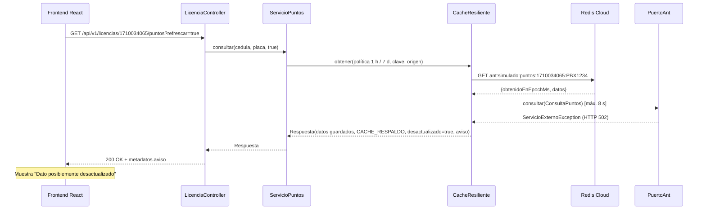

# C4 nivel 4: código (ms-ant + módulo common)

IcePanel modela hasta el nivel 3 (componentes). El nivel 4 es el diagrama de clases del código real; se documenta
aquí en Mermaid (GitHub lo dibuja directamente) para el núcleo de resiliencia, que es la parte que evalúa la tarea.
Cada clase corresponde a un archivo de `backend/`.

```mermaid
classDiagram
    direction TB

    class LicenciaController {
        -ServicioPuntos servicio
        +puntos(cedula, placa, refrescar) Respuesta~PuntosLicencia~
    }
    class SimulacionController {
        -ObjectProvider~AdaptadorAntSimulado~ simulado
        +estado() EstadoAnt
        +cambiar(CambioEstado) EstadoAnt
    }
    class ServicioPuntos {
        -PuertoAnt ant
        -CacheResiliente cache
        -PoliticaCache politica
        -ExecutorService ejecutor
        +consultar(cedula, placa, refrescar) Respuesta~PuntosLicencia~
        -conTiempoLimite(ConsultaPuntos) PuntosLicencia
    }
    class PuertoAnt {
        <<interface>>
        +consultar(ConsultaPuntos) PuntosLicencia
        +nombre() String
        +esSimulado() boolean
    }
    class AdaptadorAntWeb {
        -HttpClient http
        +consultar(ConsultaPuntos) PuntosLicencia
        ~extraer(identificacion, html) PuntosLicencia
    }
    class AdaptadorAntSimulado {
        -AtomicReference~EstadoSimulacion~ estado
        +consultar(ConsultaPuntos) PuntosLicencia
        +setEstado(EstadoSimulacion)
    }
    class EstadoSimulacion {
        <<enumeration>>
        DISPONIBLE
        CAIDO
        LENTO
    }
    class ConsultaPuntos {
        <<record>>
        tipoIdentificacion
        identificacion
        placa
    }
    class PuntosLicencia {
        <<record>>
        identificacion
        titular
        int puntos
        int puntosMaximos
        List~Citacion~ citaciones
        BigDecimal totalPendiente
    }
    class Citacion {
        <<record>>
        numero
        fechaEmision
        infraccion
        int puntosRestados
        BigDecimal valor
        estado
    }

    class CacheResiliente {
        -AlmacenCache almacen
        -ObjectMapper mapper
        -Clock reloj
        +obtener(politica, clave, tipo, refrescar, origen) Respuesta~T~
    }
    class PoliticaCache {
        <<record>>
        fuente
        boolean simulado
        Duration vigencia
        Duration retencion
    }
    class AlmacenCache {
        <<interface>>
        +leer(clave) Optional~String~
        +guardar(clave, valor, ttl)
    }
    class AlmacenRedis {
        -StringRedisTemplate redis
    }
    class AlmacenMemoria {
        -Map datos
    }
    class Respuesta~T~ {
        <<record>>
        T datos
        Metadatos metadatos
    }
    class Metadatos {
        <<record>>
        Origen origen
        fuente
        boolean simulado
        OffsetDateTime obtenidoEn
        boolean desactualizado
        aviso
        long vigenciaSegundos
    }
    class Origen {
        <<enumeration>>
        SERVICIO_EXTERNO
        CACHE
        CACHE_RESPALDO
    }
    class ServicioExternoException {
        -String servicio
    }
    class ApiException {
        -HttpStatus estado
        -String codigo
        -List~DetalleError~ detalles
    }
    class ManejadorErrores {
        <<RestControllerAdvice>>
        +negocio(ApiException) ApiError
        +servicioExterno(ServicioExternoException) ApiError
        +validacion(MethodArgumentNotValidException) ApiError
    }
    class ApiError {
        <<record>>
        codigo
        mensaje
        int estado
        ruta
        timestamp
        List~DetalleError~ detalles
    }

    LicenciaController --> ServicioPuntos
    SimulacionController --> AdaptadorAntSimulado
    ServicioPuntos --> PuertoAnt
    ServicioPuntos --> CacheResiliente
    ServicioPuntos ..> ConsultaPuntos
    PuertoAnt <|.. AdaptadorAntWeb
    PuertoAnt <|.. AdaptadorAntSimulado
    AdaptadorAntSimulado --> EstadoSimulacion
    PuertoAnt ..> PuntosLicencia
    PuntosLicencia *-- Citacion
    CacheResiliente --> AlmacenCache
    CacheResiliente ..> PoliticaCache
    CacheResiliente ..> Respuesta
    AlmacenCache <|.. AlmacenRedis
    AlmacenCache <|.. AlmacenMemoria
    Respuesta *-- Metadatos
    Metadatos --> Origen
    AdaptadorAntWeb ..> ServicioExternoException : lanza
    AdaptadorAntSimulado ..> ServicioExternoException : lanza (CAIDO)
    CacheResiliente ..> ServicioExternoException : captura → respaldo
    ManejadorErrores ..> ApiError
    ManejadorErrores ..> ApiException
    ManejadorErrores ..> ServicioExternoException
```

## Secuencia: la ANT falla y se responde con el respaldo

